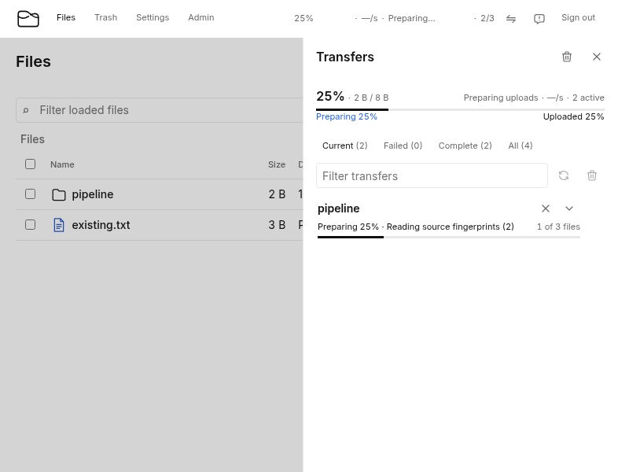

# Bulk upload recovery and preparation

The reconnect incident issued 7,914 control requests for 2,638 old upload IDs:
one status, resume, status sequence per item. Expired authority was correctly
rejected, but reconnect retained the expired IDs and the group retained an old
rate-limit message. Ordinary data transfer and atomic publication remain the
fast path. Recovery now shares metadata reads and independently classifies
bounded pages instead of amplifying those failures.

## Contracts and compatibility

The three POST recovery routes require authentication, exact origin, CSRF,
strict JSON and the existing 1 MiB request limit. Each accepts 1–100 unique
upload IDs, preserves input index and ID, and checks owner and area before
returning status. The response is limited to 1 MiB and is never cacheable.
Errors carry closed error kinds and the request reference, without provider
errors or capabilities. Status never returns capabilities; resume returns only
ephemeral capabilities with the original authoritative deadline.

Terminal actions use existing canonical upload records as receipts. Completion
binds its CRC32C and cancellation binds the immutable upload ID. All eligible
completion items publish together, as do eligible cancellation items; invalid
siblings receive independent outcomes. A metadata proof is private to one
request and reusable only for the exact upload-record logical version and
checksum. A second bounded shared read handles concurrent changes; persistent
contention returns unknown/retryable. Uncertain responses are replayable.
Admission retains its exact ordered membership and stable item keys. The
ordinary 10,000-item atomic completion/cancel routes remain supported. The UI
uses independent terminal actions after an explicit rejected atomic cohort;
network ambiguity preserves and replays the original atomic cohort.

No authoritative field, record encoding, feature requirement or CAS/freeze
protocol changes. This therefore shares schema 012 and its portable checkpoint
contract. Native capabilities and proof maps remain transient. New operation
keys use the existing fingerprint-bound batch receipt format.

## Measured comparison

The deterministic portable engine over the memory object backend compares 100
cold active sessions using a serial status/resume/status loop and the selected
shared page. Values use the retained GCS regional Standard pricing/latency
model, not a live benchmark. Separate shared contracts qualify behavior over
the GCS protocol fake.

| Metric | Scalar sequence | Shared page |
| --- | ---: | ---: |
| Browser requests | 300 | 1 |
| State backend GETs | 900 | 3 |
| Native progress/resume calls | 300 | 200 |
| State response bytes | 14,743,500 | 49,145 |
| Modeled marginal cost, pico USD | 360,000,000 | 1,200,000 |
| Modeled critical p50, µs | 23,941,000 | 86,470 |
| Modeled critical p95, µs | 70,641,000 | 255,470 |
| Modeled critical p99, µs | 174,141,000 | 630,470 |

The scalar baseline is serial. The existing 100-worker browser path can overlap
requests and already shares in-flight immutable-pack reads, so the table does
not establish its concurrent latency, memory or cost improvement. That complete
comparison remains unmeasured. The browser-envelope reduction is independently
proved by the synthetic 2,638-item regression.

The measured recovery workloads create no temporary or retained objects.
Existing namespace reading can still compact metadata at its delta-window
boundary; those maintenance costs are outside this cold-page fixture. Each page
retains at most 100 selected records/lease copies; native I/O shares the existing
qualified 100-slot engine budget across recovery/action pages. It never
downloads file bodies. Expired pages perform no native file-provider work;
terminal action replay performs no file-provider work. Exact request, cost and
latency vectors for active/status/expired/mixed-action/replay workloads are
append-only ratchet 014. Request kinds, roles and subsystems remain instrumented.
This does not bound the number of separate admission segments represented in
an arbitrary page: each distinct selected segment may require a metadata read.

The shared view avoids repeated HTTP/authentication envelopes while retaining
bounded necessary provider probes. Per-item namespace mutation was rejected
because independent outcomes can be coalesced through the existing atomic
protocol. A new durable per-item operation format was unnecessary because
immutable upload receipts already bind terminal intent.

## Browser behavior and tests

The owner ledger preserves completed siblings. Preparation uses declared-byte
weights plus one unit per empty file, credits ready members exactly once, and
shows pending source/directory/planning/hash/recovery/session phases. Confirmed
upload bytes remain separate. Source reconnection recomputes fingerprints;
matching name/size/mtime is insufficient identity. Fresh expired attempts renew
the durable identity before admission, discard old bindings, and reset only
their own confirmed bytes. New item IDs, group references and deletion of the
old item IDs commit in one IndexedDB transaction. A quota/write failure keeps
the old ledger and blocks new admission until an explicit retry succeeds.
The batch admission key must also commit before a renewed attempt can send its
request, including replay after reload. Admission captures immutable ordered
intent and binds replies to owner, local ID and attempt generation. A late
reply cannot supply capabilities to a cancelled or replaced attempt; abandoned
old sessions are cancelled only while the original owner remains signed in.
Error history is bounded to three records.

The synthetic 2,638-item browser test settles in 27 recovery requests and keeps
rendered rows bounded. A delayed shared response cannot resurrect a cancelled
sibling. The reconnect regression credits seven completed siblings at 70%
while recovering three expired sessions, clears the stale group error, and
finishes at 100%. Local fixture files and isolated test data planes are used;
these tests make no production load or customer-data claim. The quota-failure
regression first reproduced admission after a failed identity write, then
proved zero new admissions and preservation of all ten prior ledger members
after reload with the strict persistence barrier. A second quota regression
allows identity persistence but rejects the admission-key write and likewise
proves zero new admissions. A held admission reply followed by cancel/retry
first reproduced reuse of the old capabilities, then proves a fresh admission
and exactly three source writes through the new capabilities.

Publication remains atomic within each eligible cohort; independent outcomes
do not promise a transaction across completion and cancellation cohorts. The
mock models outcomes in memory and is not production provider evidence. Future
provider support must pass the shared lifecycle contract, and real upload load
behavior still requires separate authorized operational observation.
